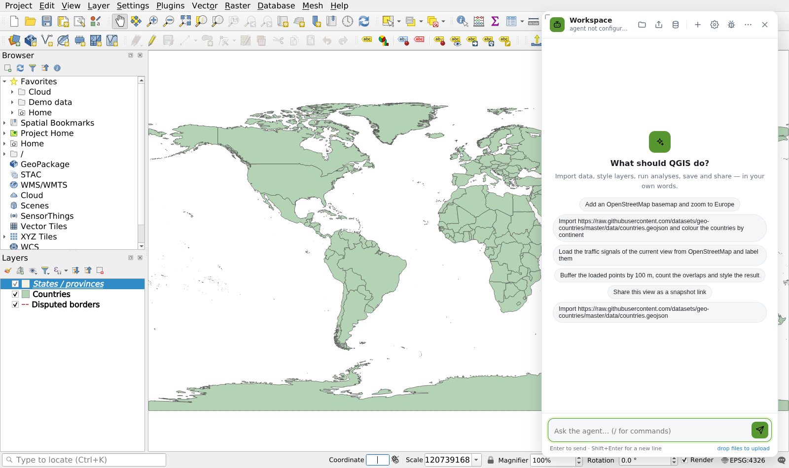
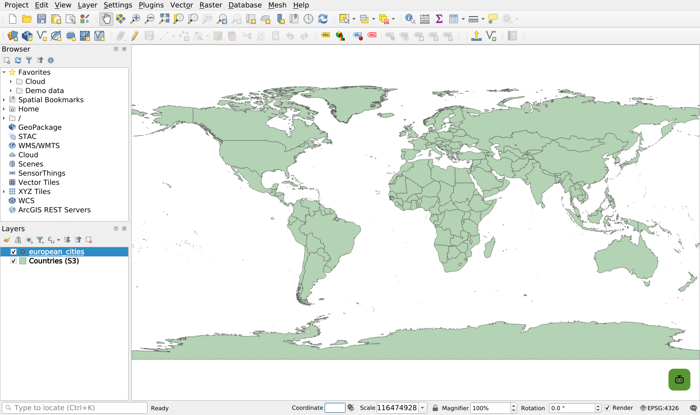
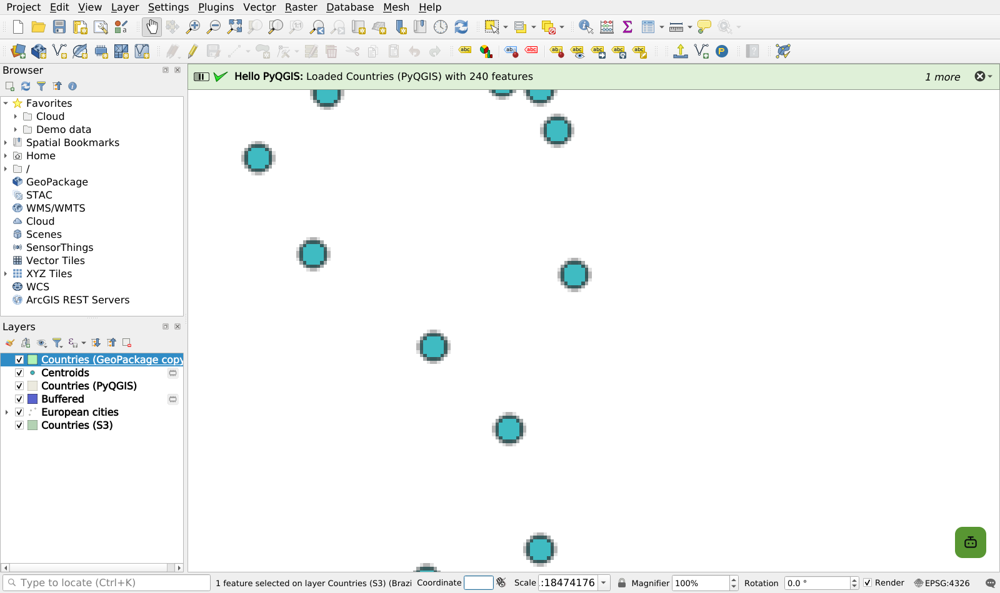
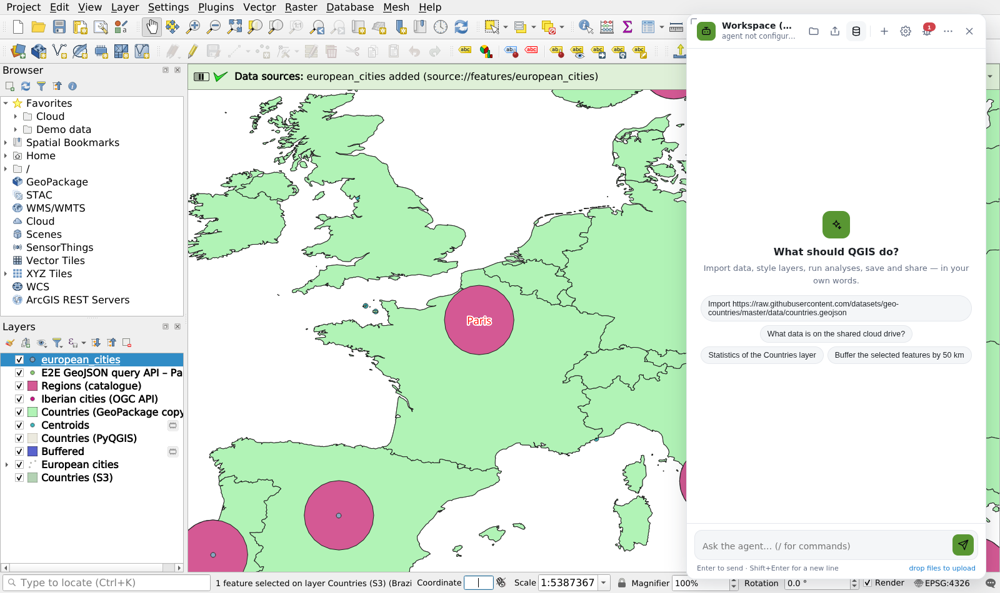
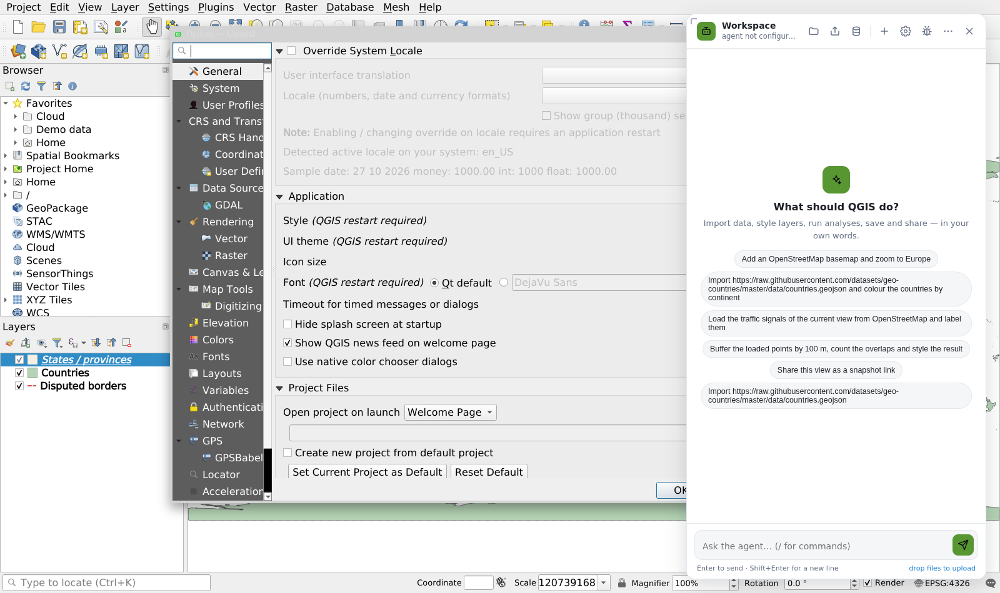
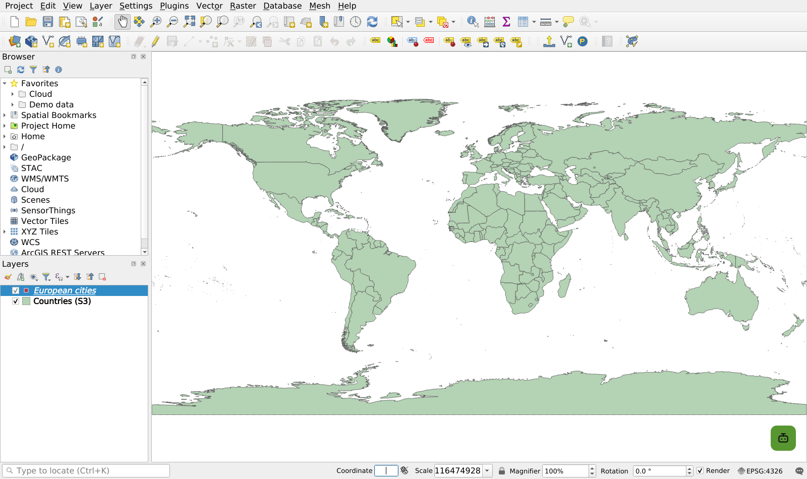

# qgis-wasm — the QGIS desktop application itself, compiled for the browser

English · [中文](README.cn.md) · [Live demo](https://eggachecat.github.io/qgis-wasm/) (GitHub Pages)

This is not a web page that looks like QGIS. What gets compiled here is the **upstream QGIS C++ source** (`qgis_core`, `qgis_analysis`, `qgis_gui`, `qgis_app`, the data providers, the upstream C++ plugins and QGIS' own `src/app/main.cpp` entry point) with Emscripten and **Qt 6.11 for WebAssembly**. The QGIS main window, menus, layer panel, map canvas, attribute table, symbology and labeling dialogs, expression builder, data source manager, options dialog… are the original Qt Widgets code, painted onto a `<canvas>` by Qt's `qwasm` platform plugin; the map is rendered by QGIS' own parallel renderer in Web Worker threads, and data is read by GDAL/OGR, PROJ and GEOS compiled to wasm.

On top of that, this repository adds what a team needs to actually use it day to day. The layering rule in one sentence: **QGIS knows only files and tool calls; URLs, sharing, presets, cloud storage protocols, external data services and models all live in the page layer** ([docs/06](docs/en/06-architecture.md)). Cloud storage, presets and plugins sit **inside** QGIS (its own filesystem, settings and menus see them); the URL scheme, sharing and query data sources are modules of the page shell; the agent is an **independent web layer** on the page that drives QGIS through a tool contract ([docs/05](docs/en/05-web-agent.md)):

| | |
|---|---|
| **Pluggable cloud storage** | Object stores with a Swift style interface (`…/v1/AUTH_…/container`), S3 compatible stores and HTTP directories mount as `/cloud/<name>` in the virtual filesystem; QGIS' Browser panel, open/save dialogs, GDAL and project saving all work on them directly. SigV4 signing in the browser, ranged reads, write-back on close; servers without CORS go through a same-origin proxy |
| **Injectable query data sources** | Services that only have data once you ask — OGC API Features, data catalogues, internal APIs returning GeoJSON — are **one line** in the preset (`sources`) and appear at once as agent tools, in the QGIS menu (Plugins → Data sources) and in links (`?add=source://…`); a new protocol is one JS file (`qgisSources.registerType()`), no QGIS change |
| **URLs and sharing** | Two kinds of link with two meanings. **Snapshot** (`project_share`, Share → "Share a snapshot"): the project *and every layer file that exists only in this browser* are copied into `<mount>/projects/<id>/` on the cloud mount with a manifest of where each layer came from; the short link `?share=<id>` opens exactly what you saw, frozen; "Refresh this snapshot from its sources" re-runs the recorded queries in place. **Live link** (`view_link`, "Copy a live link to this view"): a recipe `?add=source://… &basemap=… &extent=…` that re-queries its sources when opened — nothing stored, good for live data and for links built by other systems. The URL scheme `?share ?open ?add ?basemap ?crs ?extent ?ask` is composable and dialog-free |
| **Presets** | One JSON describing the organisation's defaults: settings, basemaps (XYZ connections), favourites, mounts, query sources, web plugins, startup project, assistant configuration; selected with `?preset=team-a` |
| **Agent** | A control surface of ≈55 tools inside QGIS (`QgsWasmBridge`, additive only); external agents drive it through the built-in **MCP server** (Claude Code connects with one command); the **Web Agent** on the page (`web/agent/`, button bottom right → floating card): model loop, skills (import / analysis…, publishable by URL), MCP client for internal data sources, tool approval policy, three-level configuration (defaults ← preset ← user), and a standalone page that drives a QGIS tab remotely |
| **Plugins** | **Python plugins** (Pyodide + a PyQGIS compatibility layer: `QgsProject`/`QgsVectorLayer`/`iface`/`processing.run` are written as usual, menu entries land in the real QGIS menus) + web plugins (JS) + C++ plugins linked in statically (Topology Checker and Geometry Checker are included); migration guide included |

| | |
|---|---|
|  |  |
| The QGIS 4.2 main window after startup: Browser panel, Layers panel, QML welcome page, status bar | `?open=/qgis/share/demo/world.qgs`: a GeoPackage project with three layers |
|  |  |
| A layer added from the S3 mount `/cloud/gis/data/world_map.gpkg` (ranged reads) | An external MCP client calls `layer_select` to select Brazil and zoom to it |
|  |  |
| The workspace's Data menu: every query source with its collections one click from the map, and the cloud mounts | Web Agent: catalogue MCP tool (search) → skill tool `import_data` (download → add layer → zoom) → summary; the panel is a card floating over the map, draggable and resizable, taking no width from QGIS |
|  |  |
| Settings → Options: a modal dialog (`QDialog::exec()`, nested event loop via JSPI) | e2e: a `project_share` link on the S3 mock opened in a new tab |

Documentation: [the index](docs/README.md) · [01 Technical approach](docs/en/01-approach.md) (why it works, every change to QGIS, trade-offs) · [02 Runtime and debugging](docs/en/02-runtime-and-debugging.md) · [03 Plugins and migration](docs/en/03-plugins-and-migration.md) · [04 Cloud storage, presets, agent](docs/en/04-cloud-presets-and-agent.md) · [05 Web Agent](docs/en/05-web-agent.md) · [06 Architecture and layering](docs/en/06-architecture.md) · [BUILD.md](docs/BUILD.md) (toolchain, build, run, test) · [AGENTS.md](AGENTS.md) (how to work in this repository). Every document also exists in Chinese — see the [index](docs/README.md).

## How this differs from qgis-js

[qgis-js](https://github.com/qgis/qgis-js) is the upstream project that first compiled QGIS to WebAssembly, and this repository stands on its shoulders: the same QGIS commit and the same vcpkg toolchain (Qt 6.11.1, GDAL 3.12, PROJ 9.8, GEOS 3.14 as wasm ports) come from there. The goals differ. qgis-js is a **headless rendering library**: it compiles `qgis_core` only, exposes about twenty functions to JavaScript (`loadProject`, `renderImage`, `renderXYZTile`, `identify`, `renderLegend`, map themes, variables…) and hands the finished pixels to the page, which usually shows them in an OpenLayers map through `@qgis-js/ol`. Its README says so itself: *"No Qt GUI provided"* — the interface you see in its demo is OpenLayers plus a project selector, not QGIS. This repository compiles the **whole desktop application** (`qgis_core` + `qgis_analysis` + `qgis_gui` + `qgis_app`, the providers, the C++ plugins) and runs QGIS' own `main.cpp`, so what appears in the browser is the QGIS main window with every one of its dialogs.

| | qgis-js | qgis-wasm (this repository) |
|---|---|---|
| What is compiled | `qgis_core` + five providers (the vcpkg port builds QGIS with `WITH_GUI=OFF WITH_DESKTOP=OFF`), no patch to QGIS | `qgis_core` + `qgis_analysis` + `qgis_gui` + `qgis_app`, the providers, upstream C++ plugins, QGIS' `src/app/main.cpp`; one patch ([`patches/qgis-wasm.patch`](patches/qgis-wasm.patch)) |
| User interface | None ("No Qt GUI provided"); the page builds its own, typically with OpenLayers | The original QGIS desktop GUI: Qt Widgets painted onto a `<canvas>` by Qt's `qwasm` platform plugin — menus, panels, attribute table, symbology and labeling, expression builder, data source manager, Processing toolbox, options… |
| How it is driven | A JavaScript API: load a project, render an extent or an XYZ tile to `ImageData`, identify, legend, themes, variables | People use QGIS as on the desktop; programs use the ≈55-tool control surface (`QgsWasmBridge`), the built-in MCP server and the Web Agent |
| Nested event loops (`QDialog::exec()`) | Not needed — there are no dialogs | JSPI (Chrome ≥ 137 and other JSPI browsers; an Asyncify build for browsers without it, [docs/06](docs/en/06-architecture.md)) |
| Rendering | `QgsMapRendererParallelJob` / `QgsMapRendererSequentialJob` into a `QImage`, the pixels are copied to the page | QGIS' own parallel renderer in worker threads, drawn by the real map canvas |
| Threads | WebAssembly threads (SharedArrayBuffer, COOP/COEP headers) | Same |
| Network data | "Network-based layers (e.g. WMS, WFS, WMTS, XYZ, COG, Vector Tiles) are not supported at the moment" (its README) | XYZ basemaps, files over HTTP(S) and the cloud mounts (`/cloud/<name>`: Swift, S3 compatible, HTTP directory); servers without CORS go through a same-origin proxy |
| Python | None ("No Python (PyQGIS) available") | Python plugins: Pyodide + a PyQGIS compatibility layer (`iface`, `QgsProject`, `QgsVectorLayer`, `processing.run`…) |
| Browsers | Chromium ≥ 95, Firefox ≥ 100 | Chrome ≥ 137 / any browser with JSPI (Safari 27 and Firefox: [docs/06](docs/en/06-architecture.md)) |
| Around it | npm packages `qgis-js`, `@qgis-js/ol`, `@qgis-js/utils`; a demo site | Presets, cloud storage, injectable query data sources, snapshot and live links, workspace, Debug view, agent + MCP, deployment scripts |
| Status | Public beta, "work in progress", "the API surface is very limited at the moment" | In daily use behind a team's deployment; e2e suites in `tests/`; a static demo site via `scripts/export-pages.sh` |

Pick qgis-js when a web application only needs QGIS to *render* a project — a map viewer, tile rendering, embedding a `.qgz` in an existing OpenLayers or MapLibre page. Pick this repository when people need to *work* in QGIS — edit symbology, open the attribute table, run Processing, write and use plugins — without installing it.

## QGIS version and our changes

| | |
|---|---|
| QGIS source | Upstream [qgis/QGIS](https://github.com/qgis/QGIS) **tag `final-4_2_3`** (QGIS 4.2.3 "Belém do Pará", commit `b041a189`), pinned to that commit as the submodule `external/QGIS`; no third-party fork |
| Our delta | A single patch, [`patches/qgis-wasm.patch`](patches/qgis-wasm.patch): every change to the upstream source (CMake, `__EMSCRIPTEN__` guards, the new `cmake/QgisWasmApp.cmake`, `src/app/qgswasm*.{h,cpp}`, `src/core/qgswasmtrace.h`, …), explained item by item in [docs/01](docs/en/01-approach.md#changes-to-the-qgis-source) |
| Applying it | `scripts/apply-patches.sh` (once, after a clean `git submodule update --init`) |
| Exporting changes | `scripts/export-patches.sh` (rewrites the patch from the `external/QGIS` working tree relative to `final-4_2_3`) |

Upgrading QGIS: move the submodule to the new tag → `scripts/apply-patches.sh` (resolve conflicts one by one along the `__EMSCRIPTEN__` guards) → `scripts/export-patches.sh` → rebuild.

## Building

Prerequisites: Linux x86-64 with git, cmake, ninja, python3, flex, bison, pkg-config and Node.js ≥ 18 (only for the local server / MCP / tests). On a 32-core, 94 GB machine the dependencies take about an hour (Qt itself is minutes; the bulk is qtdeclarative's host tools) and QGIS about 25 minutes.

```bash
git clone --recurse-submodules https://github.com/eggachecat/qgis-wasm.git qgis-wasm && cd qgis-wasm
scripts/bootstrap.sh          # emsdk 6.0.10 + vcpkg (pinned commit)
scripts/apply-patches.sh      # apply patches/qgis-wasm.patch to external/QGIS
scripts/build-deps.sh         # vcpkg: Qt 6.11 wasm, GDAL, PROJ, GEOS, GSL, QScintilla… (triplet wasm32-emscripten-qt-threads)
scripts/build-qgis.sh         # cmake configure + build QGIS → build/qgis/output/bin/{qgis.js,qgis.wasm,qgis.data,qgis.lazy.json,index.html,qgis-shell.js,cloudfs.js,presets/,plugins/}
node scripts/serve.mjs --port 8123   # static server (COOP/COEP headers) + MCP server (/mcp) + CORS proxy (/proxy)
# open in the browser: http://127.0.0.1:8123/            (Chrome ≥ 137 / any browser with JSPI)
#          http://127.0.0.1:8123/?open=/qgis/share/demo/world.qgs
#          http://127.0.0.1:8123/?preset=team-a&open=/cloud/gis/projects/x.qgz
#          http://127.0.0.1:8123/?ask=add%20a%20basemap%20and%20zoom%20to%20Europe
#          http://127.0.0.1:8123/?basemap=OpenStreetMap&add=/cloud/shared/data/x.gpkg|layername=roads&add=source://features/rivers?bbox=-10,35,5,45&extent=-10,35,5,45
# scripts/build-qgis.sh ends with scripts/compress-bundle.mjs: .br/.gz sidecar files, so the first load is ≈34 MB instead of ≈166 MB (serve.mjs / nginx brotli_static);
# on-demand files such as world_map.gpkg (qgis.lazy.json) are downloaded on first read; qgis.bundle.json (sizes) feeds the loading page,
# which shows real megabytes per file, the stage (download → compile → profile → QGIS) and what is happening and why
```

`QGIS_WASM_BUILD_TYPE=Release` (default) / `Debug`; `cmake -DQGIS_WASM_NESTED_LOOPS=jspi|asyncify|none`, `-DQGIS_WASM_PROFILING_FUNCS=OFF` (drops function names, wasm 15 MB smaller), `-DQGIS_WASM_STATIC_PLUGINS=…` (which C++ plugins to link in), `-DQGIS_WASM_LAZY_FILES=src@vfs-path;…` (large resources kept out of qgis.data and downloaded on first read; default `world_map.gpkg`).

When the browser is not on the build machine: SharedArrayBuffer needs a secure context, so forward the port with `ssh -L 8123:127.0.0.1:8123 <host>` and open `http://127.0.0.1:8123/`, or deploy behind HTTPS.

## Deployment (a shared host)

```bash
scripts/deploy.sh my-host https://qgis.example.com    # [ssh host] [public url] [install dir=/srv/qgis-wasm] [port=8123]
```

The script refreshes the shell/agent files and `.br`/`.gz` sidecars in the bundle, rsyncs it with `scripts/serve.mjs` and `deploy/*` to the host, and runs `deploy/remote-install.sh` there: a systemd service (`deploy/qgis-wasm.service`, system-wide with sudo, otherwise `--user`) running `serve.mjs --shared --host 127.0.0.1`, plus the nginx site `deploy/nginx-qgis.conf` when nginx and a certificate for the host name are present (`TLS_CERT=… TLS_KEY=…` to name them; without a certificate the site listens on :80 for a TLS load balancer in front). Rerun after every build; only changed files are transferred.

`--shared` is what makes one server safe for many people's tabs: every MCP / agent call must name the page it drives (`/mcp?client=<id>`; each page gets an unguessable id and shows its endpoint under Plugins → Share → "Copy MCP endpoint of this page"), a result is accepted only from that page, the client listing is off, and the CORS proxy only reaches hosts the presets name (plus `--proxy-allow`). Without the flag (a developer's machine) a call goes to the most recent page and the proxy reaches anything. The TLS front must keep what serve.mjs sends: `Content-Type: application/wasm`, `Cache-Control: no-cache` + ETag and the `Content-Encoding` of the sidecars; with them the second visit is ≈1 s (`tests/e2e/warm.py`).

## Static hosting (GitHub Pages, any file server)

The bundle also runs from a plain static host. Two things a static host cannot do are handled on the page: cross-origin isolation (threads need COOP/COEP headers) comes from a small service worker (`web/shell/coi-serviceworker.js`, registered automatically when the headers are missing — the page reloads once), and the 134 MB `qgis.wasm` travels as `qgis.wasm.gz` (GitHub rejects files over 100 MB) and is inflated in the browser with `DecompressionStream` while it streams. Without the server the MCP endpoint, the CORS proxy and the agent transport are off; everything else works.

```bash
scripts/export-pages.sh gh-pages     # → gh-pages: the built bundle as a static site (.nojekyll, qgis.wasm.gz, qgis.data.gz)
```

Push it as `gh-pages` and point GitHub Pages at it (Settings → Pages → Deploy from a branch → `gh-pages`, root); this repository's copy runs at https://eggachecat.github.io/qgis-wasm/ .

**Cloudflare Pages** hosts the same bundle, and is faster for most visitors: `scripts/export-static.mjs` writes a `_headers` file so the edge sends `Cross-Origin-Opener-Policy` / `Cross-Origin-Embedder-Policy` itself (threads without the service-worker reload), and puts any member over Pages' 25 MiB per-file limit on an R2 bucket (`qgis.bundle.json` carries its absolute URL, served with CORS and a custom domain). `scripts/deploy-cloudflare.sh` does both with a `CLOUDFLARE_API_TOKEN`; the bucket, its custom domain and the Pages custom domain are one-time dashboard steps. Continuous delivery: `tests.yml` runs the fast checks (layering, SigV4, shared server, docs links, OSS guard) on every push; `pages.yml` rebuilds and publishes `gh-pages` — it needs a self-hosted runner, because a from-scratch build wants ~110 GB of build tree and hours of CPU. On a machine that already has the toolchain, `scripts/release.sh` does build → publish → push in one command. The branch holds ≈ 55 MB of build output and is pushed to GitHub only: a remote with a small per-file limit refuses it, and GitHub Pages does not serve Git LFS objects.

## Tests

```bash
python3 tests/e2e/smoke.py --remote https://raw.githubusercontent.com/nvkelso/natural-earth-vector/master/geojson/ne_110m_admin_0_countries.geojson
#  startup, demo project rendering (pixel check), remote GeoJSON → sublayer dialog → rendering, modal dialog open/close
python3 tests/e2e/features.py [--llm]
#  control surface, presets, S3 mount (SigV4 mock) read/write/share link, web plugin, Python plugin, C++ plugin, Processing, map export, MCP, share link opened in a second tab;
#  shell: the query source types (catalogue / OGC API Features / GeoJSON template / Overpass mock; a deployment's own type when its overlay is present), link parsing, both view_link branches,
#  a deep link reproduced in a new tab, the Share and Data sources menus, the workspace (menus, collections one click from the map, links), the loading page's byte counts,
#  the preflight page without JSPI, .br sidecar negotiation, on-demand files;
#  --llm: the Web Agent with the model named in the preset's agent section + a mock catalogue MCP server completes "search → load → zoom"
python3 tests/e2e/agent.py
#  Web Agent (28 checks) against a scripted mock model (tests/mock-llm.mjs): tool discovery, the agent inside the workspace (card / dock layout), tool loop, MCP → skill,
#  approvals, slash commands, both providers, user configuration, upload, remote control from the standalone page
python3 tests/e2e/warm.py
#  cold vs warm start in one browser profile: the second load moves only ETag revalidation headers for qgis.wasm/.data/.js and the main window is up in ≈1 s
#  (cold: from 1.4 s, bounded by the disk the browser writes its cache to, not by wasm compilation)
node tests/layering.test.mjs && node tests/cloudfs-sign.test.mjs && node tests/serve-shared.test.mjs
#  without a browser: the layering guard (QGIS never reads the page, the page reaches QGIS only through window.qgis,
#  the agent depends on the contract alone, every tool name is registered); SigV4 signing; serve.mjs --shared (page addressing,
#  result ownership, proxy allowlist and redirects, developer defaults unchanged)
```

Playwright + the local `/usr/bin/google-chrome` (SwiftShader); screenshots go to `docs/screenshots/`. `tests/e2e/drive.py` scripts clicks, keys, wheel, JS evaluation and screenshots.

## Integration and usage

**Cloud storage**: the preset's `mounts` (or `qgis.mount({...})` in the console). A team's preset mounts its stores (direct when possible, automatically through the same-origin `/proxy` when the service sends no CORS headers):

```json
{ "type": "swift", "name": "shared", "url": "https://swift.example.com/v1/AUTH_team/shared" }
{ "type": "s3", "name": "gis", "endpoint": "https://s3.corp.example.com", "bucket": "gis-data", "accessKeyId": "…", "secretAccessKey": "…" }
```

→ `/cloud/shared/...` appears under Favorites in the Browser panel; saving a project there writes it back to the object store; `project_share` saves the project as `shared/projects/<uuid>/<title>.qgz` and returns a shareable link (nobody has to pick a name). Details in [docs/04](docs/en/04-cloud-presets-and-agent.md).

**Presets**: `web/shell/presets/<name>.json` with the fields `settings / enforce / basemaps / favorites / mounts / share / sources / plugins / plugins_python / plugins_cpp / open / agent` (the `agent` sub-fields are in [docs/05](docs/en/05-web-agent.md) §4.5); selected with `?preset=<name>`.

**Query data sources** ([docs/06](docs/en/06-architecture.md) §4): the preset's `sources`, four built-in types:

```json
{ "name": "features", "type": "ogcapi",  "title": "Internal feature service", "url": "https://geo.corp/ogcapi" }
{ "name": "catalog",  "type": "catalog", "title": "Data catalogue",           "url": "https://data.corp/catalog.json" }
{ "name": "poi",      "type": "geojson", "title": "POI query",                "url": "https://api.corp/poi?bbox={bbox}&q={q}&limit={limit}" }
{ "name": "osm",      "type": "overpass","title": "OpenStreetMap (Overpass)",  "url": "https://overpass-api.de/api/interpreter", "limit": 5000 }
```

The fourth, `web/shell/sources-overpass.js` (type `overpass`), is OpenStreetMap through an Overpass interpreter — tag presets as collections (traffic signals, crossings, ramps, roads, buildings…), tag filters or full Overpass QL as the query, a bbox always required, and the OSM JSON converted to GeoJSON on the page; the default preset points it at the public Overpass API (point it at your own mirror for real use). A service with its own protocol is one more JS file: a web plugin that calls `qgisSources.registerType(type, { collections, search, fetch })` and is listed under the preset's `plugins` — no QGIS change, and the preset's `sources` of that type are picked up when it registers.

→ the tools `sources_list / sources_collections / sources_search / sources_load` (visible to the agent, MCP and plugins automatically), the menu Plugins → Data sources → "<title>…", and links `?add=source://<name>/<collection>?bbox=…`. All QGIS sees is a GeoJSON file appearing under `/home/web_user/sources/`.

**Links** ([docs/06](docs/en/06-architecture.md) §3): `?open=` (open a project/file through QGIS), `?add=` (add layers directly: cloud files, URLs, XYZ templates, `source://`; repeatable), `?basemap=`, `?crs=`, `?extent=xmin,ymin,xmax,ymax[@CRS]`, `?ask=`. Plugins → Share → "Copy link to this view" produces a link that reproduces the current view (tool `view_link`).

**MCP** (any agent driving the QGIS in the browser):

```bash
claude mcp add --transport http qgis http://127.0.0.1:8123/mcp     # Claude Code
node scripts/mcp-stdio.mjs http://127.0.0.1:8123/mcp              # clients that only speak stdio
```

**Web Agent**: the preset's `agent` (`provider`, `baseUrl`, `model`, `apiKey`, `mcpServers`, `skills`, `tools.confirm`, `ui`); the button bottom right opens the floating card (`ui.layout: "dock"` turns it into a docked side panel). Prefer declaring your data sources as the preset's `sources` (they are listed in the agent's state snapshot, `sources_search / sources_load` use them directly, and menus and links work too); services that need conversational retrieval get an MCP server. Business capabilities are skills (one JS file each), published by URL.

**Plugins**: a Python plugin directory (`metadata.txt` + `__init__.py` + `files.json`) or zip goes into the preset's `plugins_python`, or lives in a cloud mount and is loaded with `python_plugins {action:"load", source:"/cloud/shared/plugins/<id>"}`; web plugins go to `web/shell/plugins/` and into `plugins`; C++ plugins: see [docs/03](docs/en/03-plugins-and-migration.md). The console or the agent can run PyQGIS-style code directly with `python_run`.

## Everyday use (in the interface)

**Saving a project to a cloud mount (`/cloud/<name>`)**

1. Project → Save As… (Qt's own file dialog, browsing the virtual filesystem). The sidebar has the mounts of the preset (one click lists the container), `cloud`, `demo` and `web_user`; browse by double-clicking directories as on the desktop, or type an absolute path in the file name field.
2. Pick the directory (new ones with the dialog's "New folder" button), type a name such as `my-project.qgz`, press Enter. Saving uploads; the project shows up in the Browser panel under the mount's favourite and is still there after a page reload.
3. To share: Share → "Share a snapshot" (in the workspace header or Plugins → Share; or tell the assistant "share this", or let any agent call `project_share`). The project and every layer file that lives only in your browser are copied to `shared/projects/<id>/` and the short link `?share=<id>` lands in the clipboard; a colleague opening it gets the same project, data and view, frozen. "Refresh this snapshot from its sources" re-runs the recorded queries later. For live data use "Copy a live link to this view": a recipe that re-queries when opened (`view_link`). Links can also be assembled by hand from `?open=` / `?add=`.
4. Opening someone else's project: Project → Open… and browse to `/cloud/shared/...`, or double-click it in the Browser panel.


**Where the agent is**

- **In the interface**: the flat green button bottom right (or `Ctrl+Shift+Space`) opens the **workspace** (open by default): a card floating over the map (right-aligned, full height with equal margins) that takes no width from QGIS; drag the title to move it, drag the top-left corner to resize it; position and size are remembered in the browser (⋯ → docked sidebar makes QGIS yield the right-hand side). Its header holds the page functions as flat icons and small menus — **Project** (save, share a snapshot, open the demo, export the map view as PNG: downloaded and opened in a new tab), **Share** (snapshot — stored and frozen; live link — a recipe; refresh a snapshot from its sources; MCP endpoint of this page; the preset's links), **Data** (search every query source; each source's collections one click from the map; cloud mounts), a **Debug** view (web and QGIS logs in one list, tool timings, main-thread stalls, memory / threads / startup phases; errors count on its button), **⋯** (layout, open at start, the preset's links, about) — and the body is the **agent**. Type natural language, for example "Add the OpenStreetMap basemap, zoom to Brazil and tell me its ISO code"; every tool call is an expandable card (arguments / result / duration), exported maps show up in the conversation, `/` lists the skill commands (`/import`, `/stats`, `/buffer`), and dropping a file onto the panel uploads it to `/home/web_user/uploads/`. By default every tool runs without interrupting you; to have certain operations (saving, removing layers…) confirmed first, list the tool names in the preset's `tools.confirm` or under "Ask before running" in ⚙, and an Allow / Deny prompt then appears pinned above the input. ⚙ changes the model, adds your own instructions, MCP servers and skills, and the approval policy; the changes live only in your browser, and "Reset to preset" returns to the organisation defaults.
- **Standalone page** (optional, for remote use / portal embedding): `agent/agent.html?qgis=http://127.0.0.1:8123` — the same agent on its own page, driving a QGIS tab remotely through `serve.mjs`.
- **External agents / scripts**: after `claude mcp add --transport http qgis http://127.0.0.1:8123/mcp`, tell Claude Code "load … in QGIS and export an image"; or `curl -X POST http://127.0.0.1:8123/agent/call -d '{"tool":"state"}'`; `assistant_ask` / `assistant_status` are tools too, so an external agent can put the in-page agent to work.
- **Your data sources**: each one provides an MCP server listed in the preset's `agent.mcpServers`; once the agent has a search result it opens it with `import_data` / `layers_add`.


## What is in the box

| Need | What this repository has |
|---|---|
| The GUI is fully usable on the web | The real QGIS desktop GUI runs in the browser (the core of this repository) |
| Pluggable project / file storage (CDN, internal S3-like stores, …) | `cloudfs.js`: three backends — Swift style, S3 compatible, HTTP directory — mounted at `/cloud/<name>`, every QGIS file operation works on them; sharing = an automatically generated `projects/<uuid>/…` + link; a new backend is one `registerBackend()` |
| Injectable external query data sources | `sources.js`: one preset line declares an OGC API Features / catalogue / GeoJSON API that automatically becomes agent tools, QGIS menu entries, workspace menu entries and link parameters; new protocols via `registerType()` — `sources-overpass.js` (OpenStreetMap) is one, a team's own gateway is a web plugin; zero QGIS changes ([docs/06](docs/en/06-architecture.md) §4) |
| Sharing, loading and URL parsing in the web layer | `share.js` + `link.js`: stored snapshots (`<mount>/projects/<id>/` with project, data and manifest; `?share=<id>`; refresh from sources; browser-local GeoJSON goes in as GeoPackage — spatial index, a third smaller, opens instantly) and live recipe links (`?open ?add ?basemap ?crs ?extent ?ask`, `view_link`); the Share menus; QGIS knows nothing about URLs — it sees files and two tools ([docs/06](docs/en/06-architecture.md) §3). Transfers never freeze the tab: snapshots upload asynchronously under a cloudfs write-behind lease, `?share=` links prefetch their files with real megabytes behind the loading veil |
| Progress for everything the page does | `progress.js`: one task bus; sharing, opening a snapshot, querying a source, downloading, applying a link report there and the workspace (strip / pill / ring), the loading page and the Debug view only listen |
| Shared team configuration / basemaps | Preset JSON (settings, XYZ basemap connections, favourites, mounts, plugins, startup project, assistant) |
| A native agent, configurable and controllable | The `QgsWasmBridge` control surface + built-in MCP server (external agents) + the Web Agent on the page (`web/agent/`: skills, MCP client, approval policy, three-level configuration, standalone remote mode; can share and open things directly); boundary design and upgrade process in [docs/05](docs/en/05-web-agent.md) |
| Plugins | Python plugins: Pyodide + PyQGIS compatibility layer (`web/shell/pyqgis/`, synchronous semantics through JSPI `run_sync`), the `hello_pyqgis` example loads by default; web plugin API; C++ plugins linked statically (Topology Checker, Geometry Checker included). Unsupported parts (custom Qt dialogs/map tools, Python Processing algorithms, threads) in [docs/03](docs/en/03-plugins-and-migration.md) |

## Branding and deployment overlays

`web/shell/brand.js` is the one file that decides how a deployment looks: product name, accent colour (exposed as `--brand-accent`), the loading spinner, optionally the rotating notes on the loading page. A deployment keeps its own `brand.js`, presets, extra page modules (its data source types as web plugins) and `deploy.env` in `internal/` and `scripts/stage-web.sh` copies that overlay over the bundle after every build (`--oss` stages the plain open-source variant). The open-source tree has no `internal/` directory; `scripts/export-oss.sh` produces it from a checkout that has one and refuses to export anything that still names the overlay's hosts or keys (`tests/oss-guard.mjs`).

## License

GPL-2.0-or-later ([LICENSE](LICENSE)), the licence of QGIS itself: the patch in `patches/` modifies QGIS, and the web layers and scripts are released under the same terms. The bundled Open Sans font is under the OFL (`web/OpenSans-OFL.txt`).

## Repository layout

| Path | Contents |
|---|---|
| `external/QGIS` | Upstream QGIS source (submodule, tag `final-4_2_3` / `b041a189`) |
| `patches/qgis-wasm.patch` | All changes to QGIS (regenerated by `scripts/export-patches.sh`) |
| `external/QGIS/cmake/QgisWasmApp.cmake` | The wasm executable target: Emscripten runtime options, preloaded QGIS data directories, static plugins, Qt finalisation, QML plugins, shell directory copy |
| `external/QGIS/src/app/qgswasmapp.*` | Browser hooks (`main.cpp` keeps only five one-line calls) + the JS entry points `qgis_wasm_open/ready/call` |
| `external/QGIS/src/app/qgswasmbridge.*` | The control surface (tool registry shared by the page, MCP and the Web Agent) |
| `external/QGIS/src/app/qgswasmpreset.*` | Preset application (settings, basemaps, favourites, enabling C++ plugins) |
| `external/QGIS/src/app/qgswasmstaticplugins.*` | Table of statically linked C++ plugins |
| `external/QGIS/src/core/qgswasmtrace.h` | `QGIS_WASM_TRACE(...)`, printed to the browser console with `?trace=1` |
| `vcpkg.json`, `build/vcpkg-ports/*`, `build/vcpkg-triplets/*`, `build/vcpkg-toolchains/*` | Dependency manifest, overlay ports (`qscintilla` and `libb2` are this repository's CMake versions), the wasm triplet |
| `web/shell/` | The browser shell: `index.html` (preflight + loading page + ordered loading), `qgis-shell.js` (presets, `window.qgis`, plugins, agent transport, startup orchestration), `workspace.js` + `workspace.css` (the page's panel: button, header menus, views, the agent's slot, running tasks), `progress.js` (the task bus), `loading.js` (the loading page), `share.js` (stored snapshots: `?share=<id>`, `project_share`, `share_refresh`), `debug.js` (the Debug view), `link.js` (URL scheme and live links), `sources.js` (query data sources) + `sources-overpass.js` (OpenStreetMap through Overpass), `brand.js` (name, accent colour, spinner — the file a deployment overlay replaces), `cloudfs.js`, `pyqgis.js` + `pyqgis/` (Python runtime and PyQGIS compatibility layer), `presets/`, `plugins/` |
| `scripts/compress-bundle.mjs` | After the build, writes `.br`/`.gz` sidecars for `qgis.wasm/.data/.js` and the on-demand files listed in `qgis.lazy.json` (served as-is by serve.mjs and nginx `brotli_static`) |
| `web/agent/` | The Web Agent: `agent.js` (entry), `agent.html` (standalone page), `core/` (host / runtime / tools / mcp / skills / config / providers), `ui/` (panel), `skills/` (built-in skills) |
| `web/` (other) | `qgis_global_settings.ini` for deployment, the Open Sans font (OFL), the demo project |
| `scripts/` | bootstrap / build-deps / build-qgis / export-patches / apply-patches / make-demo-project / stage-web (web layers + overlay into the bundle) / serve (static + MCP + proxy, `--shared` for a multi-user host) / deploy (rsync + systemd + nginx over ssh) / export-pages (the `gh-pages` static site) / export-oss, export-minimal (optional: other trees) / mcp-stdio / build-errors |
| `deploy/` | `qgis-wasm.service` (systemd unit template), `nginx-qgis.conf` (TLS site template), `remote-install.sh` (runs on the host) |
| `tests/` | `e2e/smoke.py`, `e2e/features.py`, `e2e/agent.py`, `e2e/warm.py`, `e2e/drive.py`, `e2e/stacks.py`, `layering.test.mjs` (layering guard), `serve-shared.test.mjs`, `cloudfs-sign.test.mjs`, `s3-mock.mjs`, `mock-mcp.mjs`, `mock-llm.mjs`, `data/` |
| `docs/` | `BUILD.md` (English: toolchain, build, run, test), then in Chinese: technical approach, runtime and debugging, plugins and migration guide, cloud storage / presets / agent, Web Agent (boundaries / skills / upgrades), architecture and layering; screenshots |
| `internal/` (optional) | A deployment's overlay, not part of the open-source tree: its `web/brand.js`, `web/presets/*.json`, extra page modules, `deploy.env`, mock extensions for its own services. `scripts/stage-web.sh` copies it over the bundle |
| `AGENTS.md` | How to work in this repository (for people and coding agents): layering rules, where things go, how to test, what never to commit |
