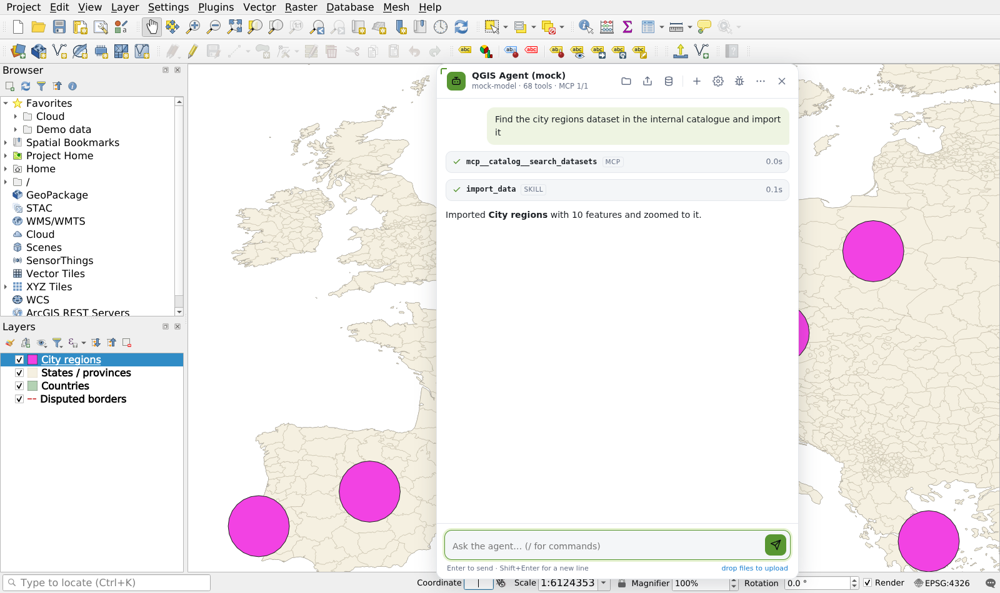
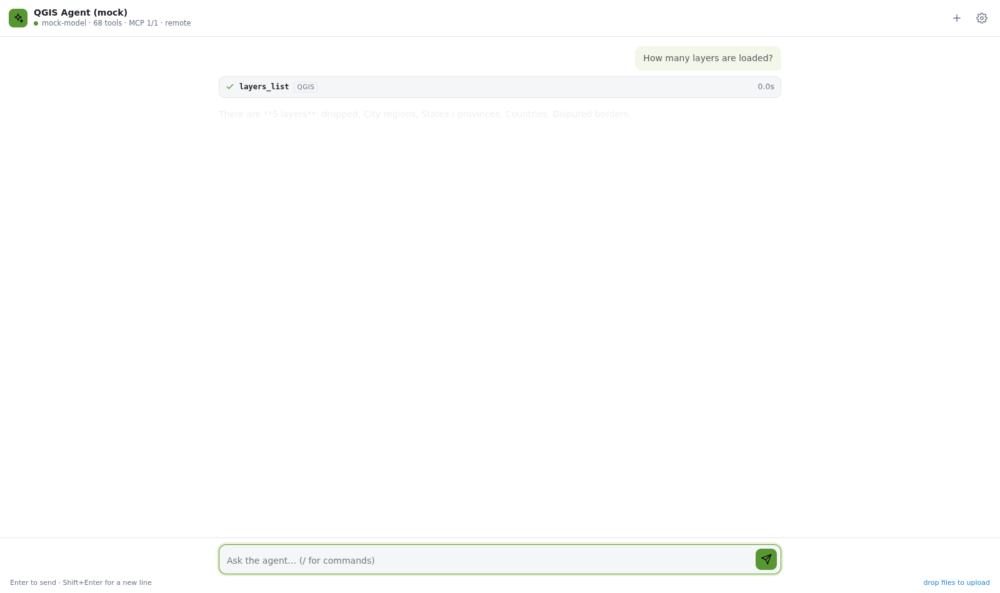

# Web Agent：边界、扩展与升级

> English: [05-web-agent.md](en/05-web-agent.md)

agent 不在 QGIS 里，而是页面上一个独立的模块（`web/agent/`），通过**一个契约**操控浏览器里的 QGIS。这样切有三个目的：功能好扩展（技能、模型、数据源都是插件式的），用户好定制（三层配置，用户层只存在自己的浏览器里），QGIS 升级成本低（QGIS 侧只有一个小而稳定的工具面，agent 一行不用改）。

```
┌───────────────────────────────── 浏览器页面 ─────────────────────────────────┐
│  web/agent  (Web Agent)                 web/shell  (宿主)              QGIS (wasm)  │
│  ┌──────────────┐  ┌────────────┐      ┌─────────────────────┐      ┌────────────┐ │
│  │ ui/panel.js  │  │ skills/*   │      │ window.qgis         │      │ QgsWasm-   │ │
│  │ (FAB + 面板)  │  │ (技能=工具+ │      │  .tools() .call()   │ ───▶ │ Bridge     │ │
│  └──────┬───────┘  │  提示词)    │      │  .on()  .registerTool│ ◀─── │ ≈50 工具   │ │
│         ▼          └─────┬──────┘      │ 页面工具: 分享/挂载/  │      │ (C++, 公开 │ │
│  ┌──────────────┐        ▼             │ Python/上传/下载      │      │  QGIS API) │ │
│  │ core/runtime │◀─ core/tools (注册表+策略) ◀─ core/host.js ──┘      └────────────┘ │
│  │ (模型循环)    │◀─ core/mcp   (内部数据源)                                         │
│  └──────┬───────┘◀─ core/providers (Responses / Chat Completions / …)                │
│         └─ core/config (DEFAULTS ← preset.agent ← 用户 localStorage)                 │
└──────────────────────────────────────────────────────────────────────────────────────┘
   agent.html?qgis=<server>  ──▶ scripts/serve.mjs /agent/call ──▶ 另一个标签页里的 QGIS（远程宿主）
```

依赖方向只有一个：**agent → 宿主契约 ← QGIS**。`web/agent` 里没有任何代码碰 `window.qgisInstance`、Emscripten 文件系统或 C++；QGIS 里没有任何代码知道有 agent 存在。

## 1. 三层与各自的职责

| 层 | 位置 | 职责 | 变化频率 |
|---|---|---|---|
| **QGIS 内核** | `external/QGIS/src/app/qgswasm*.{h,cpp}` + 5 个一行钩子 | 把 QGIS 的能力暴露成带 JSON schema 的工具（`QgsWasmBridge`），应用 preset，启动钩子 | 随 QGIS 升级重新编译；工具只增不改 |
| **宿主（shell）** | `web/shell/` | 加载 QGIS，挂云存储，加载 preset / 插件 / Python，提供 `window.qgis`（QGIS 工具 + 页面工具），对外的 SSE/MCP 传输；URL 方案与分享（`link.js`）、查询数据源（`sources.js`）也是这一层的页面工具（docs/06） | 低 |
| **Web Agent** | `web/agent/` | 模型循环、工具注册表与策略、MCP 客户端、技能、配置、UI | 高：这里是产品迭代的地方，改完刷新即生效，不编译 |

"导入""分析"这类**业务能力放在 agent 层**（技能），而不是加进 QGIS：技能可以组合多个 QGIS 工具、调 PyQGIS、访问内部 HTTP 服务，发布只是放一个 JS 文件。QGIS 侧的工具保持通用（`layers_add` 而不是 `add_geojson_from_s3`）。

## 2. 宿主契约（agent 唯一依赖的东西）

`core/host.js` 定义了 agent 眼中的 QGIS：

```js
host.tools()                 // → [{ name, description, inputSchema, source }]   MCP 风格清单，运行时发现
host.call(name, args)        // → Promise<result>                                 失败 reject，message 是工具错误
host.on(event, fn)           // QGIS 事件（layers.changed、selection.changed …），远程宿主可为空实现
await host.presetReady       // preset 读完（壳层异步 fetch presets/<name>.json；agent 等它之后才读 preset.agent，不与之竞速）
host.registerTool(name, def) // 向宿主登记页面工具（assistant_* 就是这样登记的），MCP / ?ask= / 其它 agent 因此也能看见
host.checkApi()              // qgis_version.bridgeApi 与 agent 期望的大版本比对
```

- **工具来源**用 `source` 标注：`qgis`（C++ Bridge）、`shell`（页面工具：`project_share`、`view_link`、`mounts_*`、`sources_list / sources_search / sources_load`、`download`、`upload`、`python_run`…）、`agent`、`mcp`（`mcp__<server>__<tool>`）、`skill`。面板的工具卡片显示这个标签。状态快照里带着 `sources` 名单，提示词要求模型在"数据不在图上"时先搜数据源。
- **发现而不是硬编码**：agent 启动时读清单，所以 QGIS 新增工具无需改 agent；反过来 agent 的技能若依赖某个工具，缺失时只是该技能工具报错，其它照常。
- **版本**：`qgis_version` 返回 `bridgeApi`（当前 1）。破坏性地改一个工具的参数/返回时升大版本，agent 的 `HOST_API` 随之更新；加工具、加可选参数不升版本。
- **两种宿主**：`LocalHost`（同一页面的 `window.qgis`）和 `RemoteHost`（`POST <server>/agent/call`，经 `scripts/serve.mjs` 转发到某个已连接的 QGIS 页面，`?client=` 指定）。同一份 agent 代码因此既能嵌在 QGIS 页面里，也能作为独立页面 `agent/agent.html?qgis=http://host:8123` 运行，或嵌进别的门户。

## 3. QGIS 侧：最小改动与升级流程

### 3.1 现在改了什么

| 文件 | 性质 | 内容 |
|---|---|---|
| `src/app/qgswasmapp.{h,cpp}` | 新增 | 5 个钩子（`beforeApplication` / `applyDeploymentDefaults` / `beforeMainWindow` / `showMainWindow` / `afterInitialization`）+ JS 入口 `qgis_wasm_open/ready/call` |
| `src/app/qgswasmbridge.{h,cpp}` | 新增 | 工具注册表与 ≈50 个工具，全部基于公开 QGIS API（`QgsProject`、`QgsMapLayer`、`QgsProcessingRegistry`…）；对 `QgisApp` 私有槽的少数调用走 `QMetaObject::invokeMethod` |
| `src/app/qgswasmpreset.{h,cpp}` | 新增 | preset → 设置 / 底图 / 收藏夹 / 文件对话框书签 |
| `src/app/qgswasmstaticplugins.{h,cpp}` | 新增 | 静态编入的 C++ 插件表 |
| `src/app/main.cpp` | 改 30 行 | 只剩 `#ifdef __EMSCRIPTEN__ QgsWasmApp::xxx(); #endif` 这样的钩子和两处平台 `#if` |
| 其它上游文件 | 小改 | `qgspluginregistry.cpp` / `qgspluginmanager.cpp`（静态插件分支）、`qgsnetworkaccessmanager.cpp`（不设 User-Agent）、`qgsuserprofile.cpp`（不切 ini）、各插件 CMake（静态）、`qgisplugin.h`（符号前缀）、顶层 CMake |

全部改动在 `patches/qgis-wasm.patch`（`scripts/export-patches.sh` 生成）。agent 相关的 C++ 已经为零：原来的 Assistant 停靠面板（Responses API + MCP 客户端，≈600 行 C++）删除，功能全部在 `web/agent`。

### 3.2 升级 QGIS

1. `cd external/QGIS && git fetch && git checkout <新 tag>`，`scripts/apply-patches.sh`。冲突基本只会出现在 `main.cpp` 的钩子位置和插件 CMake，`qgswasm*.cpp` 是独立文件，若上游 API 变了在这里改。
2. `scripts/build-qgis.sh all`。
3. 跑契约测试：`python3 tests/e2e/smoke.py`、`python3 tests/e2e/features.py`、`python3 tests/e2e/agent.py`。agent.py 用脚本化的模拟模型（`tests/mock-llm.mjs`）走完"发现工具 → 调用 → 技能 → MCP → 审批 → 两种 provider → 远程宿主"，不依赖真实模型；`features.py --llm` 再用真实网关验证一次。
4. 若某个工具的行为变了：改 Bridge 保持返回结构，或升 `bridgeApi` 并更新 `core/host.js` 的 `HOST_API` 与受影响的技能。

### 3.3 给 QGIS 加工具的规则

通用、无业务含义；参数与返回是 JSON（schema 写全，description 写给模型看）；只用公开 API；在 Qt 事件循环里执行（JS→C++ 只排队，见 docs/02 §2.1）；大结果给出 `limit`。加完不需要改 agent。

## 4. Agent 内部

### 4.1 模型循环（`core/runtime.js`）

```
ask(text)
  ├─ "/命令 其余" → 技能命令的 prompt + 其余
  ├─ system = 内置/preset 提示词 + 启用技能的 instructions + 用户 instructions + 当前 QGIS state 快照（每轮刷新）
  └─ 循环 ≤ maxIterations：
       provider.stream({system, items, tools})  → 流式文本（面板逐字显示）/ 工具调用
       每个工具调用：策略检查（deny / allow）→ 需确认则等待面板里的 Allow/Deny（审批条固定在输入框上方，不随对话滚走）→ 执行（超时 180 s）→ 结果 JSON（>24k 字符截断）
       无工具调用 → 结束，lastAnswer
```

事件：`turn.start` `message.added` `delta` `message` `tool.start` `confirm` `tool.end` `turn.end` `error` `status` `reset`。方法：`ask` `stop` `reset` `status` `updateConfig` `commands` `suggestions`，以及 `registry`（可直接 `registry.get('import_data').run({...})`，测试就是这么用的）。

### 4.2 工具注册表与策略（`core/tools.js`）

一张表装所有来源的工具；策略来自配置：`tools.allow`（白名单 glob，空 = 全部）、`tools.deny`、`tools.confirm`（执行前要用户点 Allow；默认为空 = 全部直接执行，preset 可列出如 `project_save`，用户可在设置里追加）。技能工具可以自带 `confirm: true`。没有 UI 时（纯 MCP 调用 `assistant_ask`）不会卡住：无确认处理器即放行。

### 4.3 模型提供方（`core/providers/`）

接口就是一个异步生成器：`for await (ev of provider.stream({system, items, tools, signal}))` 产出 `{type:'text', delta}`、`{type:'tool_call', callId, name, arguments}`、`{type:'done', text, usage}`。已有 `openai-responses`（网关默认，流式 + 非流式回退）和 `openai-chat`（Chat Completions：OpenAI 兼容网关、Ollama、vLLM）。加一个提供方 = `providers/` 里一个文件 + `index.js` 一行（或运行时 `registerProvider()`）。

### 4.4 MCP 客户端（`core/mcp.js`）

Streamable HTTP：`initialize` → `notifications/initialized` → `tools/list`，调用 `tools/call`；支持 JSON 与 SSE 响应、`Mcp-Session-Id`、自定义 headers；`proxy: 'auto'` 先直连，CORS 失败再经同源 `/proxy?url=`。结果里的 `image` 内容块显示在面板里。内部数据源接入 = preset `agent.mcpServers` 加一行，或用户在设置里加。

### 4.5 配置的三层（`core/config.js`）

`DEFAULTS` ← preset 的 `agent` 段（组织维护：模型、key、系统提示词、MCP 服务器、技能、策略、面板选项）← 用户层（`localStorage["qgis-wasm.agent"]`：模型/地址/key 覆盖、自己的 instructions、追加的 MCP 服务器与技能、停用的技能、策略覆盖、面板开关）。用户**只能追加**，不能拿掉 preset 给的东西；"重置为 preset"清掉用户层。

```json
"agent": {
  "provider": "openai-responses", "baseUrl": "https://api.example.com/v1", "model": "…", "apiKey": "…",
  "systemPrompt": "（可选，替换内置提示词）",
  "mcpServers": [{ "name": "catalog", "url": "https://geo-catalog.internal/mcp", "proxy": "auto" }],
  "skills": ["agent/skills/import-wizard.js", "agent/skills/analysis.js", "https://cdn.internal/qgis-skills/stac.js"],
  "tools": { "confirm": ["project_save", "layers_remove"], "deny": ["settings_*"] },
  "hints": "部署说明，追加到系统提示词：常用地点的坐标 / bbox、组织内数据源怎么用（集合与条件写法）、分享的两种语义……",
  "ui": { "title": "QGIS Agent", "suggestions": ["围绕某地从数据源取数并与底图 / 分析融合的起始任务…"] }   // 面板的位置 / 布局 / 是否启动即开属于壳层：preset 顶层 "ui": { "openOnStart", "layout", "width", "height", "title" }（docs/06 工作区）
}
```

## 5. 扩展点

### 5.1 技能（skill）——业务能力的发布单位

一个 ES 模块（或只有提示词的 JSON），放在任何能 `import()` 到的 URL（同源目录、内部 CDN、启用了 CORS 的对象存储）：

```js
export default {
  name: 'STAC', description: 'Search the internal STAC catalogue',
  instructions: `## STAC\n- Use stac_search for imagery; pass the asset href to import_data.`,
  commands: [{ name: 'stac', description: 'Search imagery', prompt: 'Search the STAC catalogue for: ' }],
  suggestions: ['Find Sentinel-2 scenes over Shanghai from last month'],
  tools: [{
    name: 'stac_search',
    description: 'Search the internal STAC API; returns items with asset hrefs that import_data can open.',
    parameters: { type: 'object', properties: { bbox: { type: 'array', items: { type: 'number' } }, datetime: { type: 'string' } } },
    confirm: false,
    async run({ bbox, datetime }, ctx) {
      const res = await ctx.fetch('https://stac.internal/search', { method: 'POST', body: JSON.stringify({ bbox, datetime, limit: 10 }) });
      return (await res.json()).features.map((f) => ({ id: f.id, href: f.assets.visual?.href }));
    },
  }],
};
```

`ctx` = `{ host, call, python, fetch, config, log }`：`ctx.call('layers_add', …)` 组合 QGIS 工具，`ctx.python.run(code)` 跑 PyQGIS（Pyodide + 兼容层），`ctx.fetch` 自动回退同源代理。内置的两个技能是模板：`skills/import-wizard.js`（`import_data`：下载 → 加图层 → 缩放 → 汇总）和 `skills/analysis.js`（`layer_statistics` + processing 用法说明）。技能也可以**只有提示词**（JSON 文件），用来给某个团队定制"怎么做事"。

### 5.2 页面工具（给 Web 插件）

`window.qgis.registerTool(name, { description, inputSchema, run, source })`：Web 插件登记的工具同时出现在 agent、MCP 服务器和 `window.qgis.tools()` 里。agent 自己的 `assistant_ask / assistant_status / assistant_reset` 就是这样登记的，所以 `?ask=…`、`features.py --llm` 和外部 MCP 客户端的用法不变。

### 5.3 换 UI

`ui/panel.js` 只用 `AgentRuntime` 的事件和方法（§4.1）。要换成 assistant-ui / React 门户：保留 `core/`，把 `agent.js` 里的 `mountPanel()` 换成你的组件；`createAgent()` 不关心页面长什么样。独立页 `agent/agent.html` 就是"没有 QGIS 的页面 + 同一个 runtime"。

## 6. 入口一览

| 入口 | 用法 |
|---|---|
| 页面里的面板 | 页面的**工作区**（`web/shell/workspace.js`，右下角扁平按钮 / `Ctrl+Shift+Space`，默认启动即开）里的槽位：工作区负责按钮、头部、浮动卡片 / 停靠侧栏、拖动缩放与记忆（`localStorage["qgis-wasm.workspace.*"]`），agent 只渲染对话并往头部加 New conversation / Settings 两个按钮（`window.qgisWorkspace.addAction`）。布局和"启动即开"在工作区的 ⋯ 菜单（或 preset 顶层 `ui`）。没有工作区的页面上（旧部署）agent 仍带自己的按钮和浮动卡片；`agent.html` 独立页整页就是面板 |
| `?ask=…` | 页面加载后自动提问（等 agent 就绪） |
| `assistant_ask / assistant_status / assistant_reset` | 页面工具：`window.qgis.call`、MCP `tools/call`、`POST /agent/call` 都能用；`assistant_status` 返回 `configured / busy / model / provider / mcpServers / skills / tools / transcript / lastAnswer` |
| `agent/agent.html?qgis=<server>[&preset=…][&client=…]` | 独立页面，经 serve.mjs 操控某个 QGIS 标签页（面向远程 / 门户嵌入；QGIS 页面里的面板没有入口，直接开这个 URL） |
| 外部 agent（Claude Code 等） | 仍然是 MCP 服务器 `/mcp`（docs/04 §3.2），和 Web Agent 共享同一套工具 |

| | |
|---|---|
|  |  |
| 页面里：目录 MCP 工具 → 技能工具 `import_data` → 汇总，卡片浮在地图上 | `agent/agent.html?qgis=…`：同一个 agent 远程操控另一标签页里的 QGIS |

## 7. 测试

- `tests/mock-llm.mjs`：脚本化模型，同时实现 Responses API 与 Chat Completions（流式 / 非流式），按用户话术决定调哪个工具、回什么。
- `tests/e2e/agent.py`（28 项）：启动与发现（来源计数、技能命令、bridgeApi）、工作区里的 agent（按钮、槽位、头部按钮；浮动卡片（画布宽度不变、占满高度、拖动/缩放/记忆、无弹出按钮）与停靠模式（画布让位）、`assistant_ask` 工具循环、MCP → 技能链路、审批允许/拒绝、斜杠命令、键入发送与图片结果、切换 provider、用户配置落 localStorage、上传 → 技能工具、`layer_statistics`、独立页远程宿主。
- `tests/e2e/features.py --llm`：真实网关 + 模拟目录 MCP，验证提示词和真实模型配合。

## 8. 取舍与已知限制

- **模型看不到图**：导出的地图和 MCP 的图片显示在面板里，但没有作为 `input_image` 发给模型（需要时在 provider 的 `toInput` 加一个消息即可）。
- **远程宿主没有事件流**：`agent.html` 只能调工具，QGIS 事件不推送（runtime 每轮刷新 state 快照，够用）。
- **Markdown 渲染依赖 CDN**（marked + DOMPurify，jsDelivr，与 Pyodide 同一策略）；拿不到时退化为纯文本。
- **一个页面一个会话**；历史不持久化（刷新即清）。需要时在 runtime 外存 `items` 即可。
- **key 在前端**：是内部部署的既定取舍（见 README），策略层只控制工具，不控制模型访问。
- 技能 URL 必须可 `import()`：对象存储上的技能需要 CORS 或走 `/proxy`；虚拟文件系统里的技能（`/cloud/...`）暂不支持直接加载。
